# Portal do Leão

**Um portal rubro-negro desenvolvido com foco em Mobile First.** 🦁🔴⚫

O **Portal do Leão** é uma aplicação web independente, criada como projeto de portfólio e inspirada na história e na paixão da torcida do **Sport Club do Recife**. A proposta é reunir em uma única experiência notícias, jogos históricos, uma loja conceitual, informações sobre o elenco, história do clube e uma área exclusiva do torcedor.

> **Aviso:** projeto educacional e não oficial, sem vínculo com o Sport Club do Recife. Não comercializa produtos ou ingressos reais.

## Prévia do projeto


## Funcionalidades

### 🏠 Página inicial

Interface rubro-negra com escudo do Sport, destaque da Ilha do Retiro, navegação para as seções e chamadas para conhecer a história e a loja.

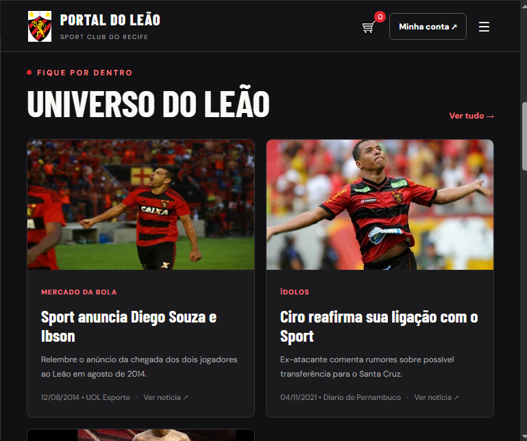

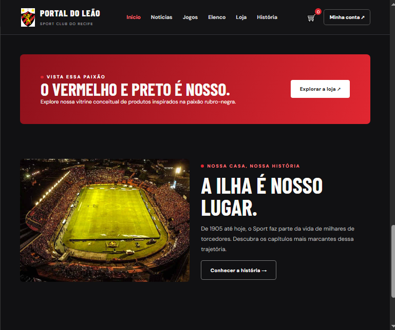

### 📰 Notícias e histórias

Listagem de reportagens com imagens, resumos e acesso à página de detalhe. Cada matéria oferece um link para a publicação original. As notícias utilizadas como exemplos abordam Diego Souza e Ibson, Ciro e Magrão.

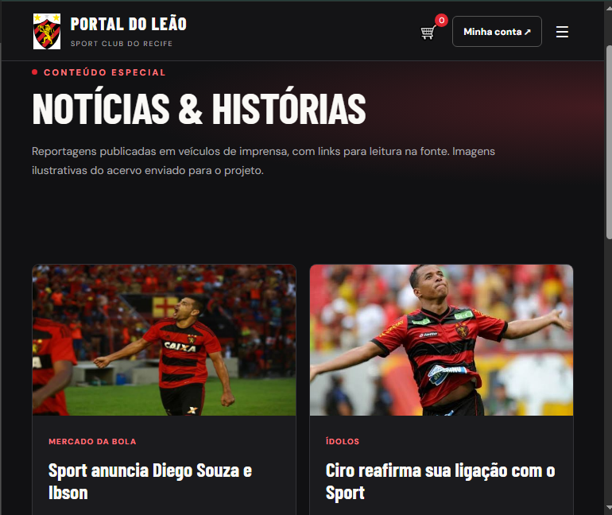

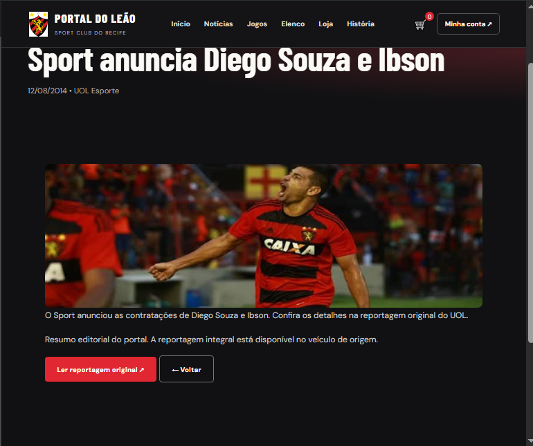

### 🎟️ Jogos históricos e ingressos demonstrativos

O visitante pode explorar três partidas históricas na Ilha do Retiro:

| Partida | Competição | Data | Horário |
| --- | --- | --- | --- |
| Sport × Santa Cruz | Final do Campeonato Pernambucano | 21/04/2001 | 16h |
| Sport × Corinthians | Final da Copa do Brasil | 11/06/2008 | 21h30 |
| Sport × Serra Talhada | Campeonato Pernambucano | 31/03/2012 | 18h30 |

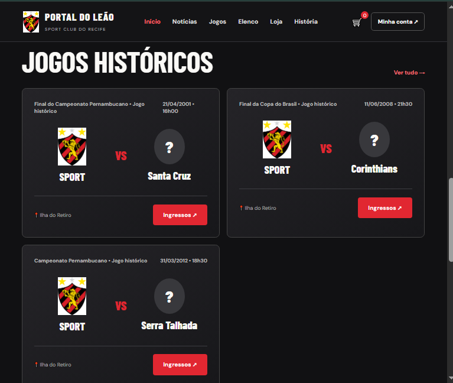

O fluxo de simulação permite selecionar **Sociais, Arquibancada Sede, Arquibancada Geral ou Camarote**, escolher de 1 a 4 ingressos e visualizar o total calculado automaticamente.

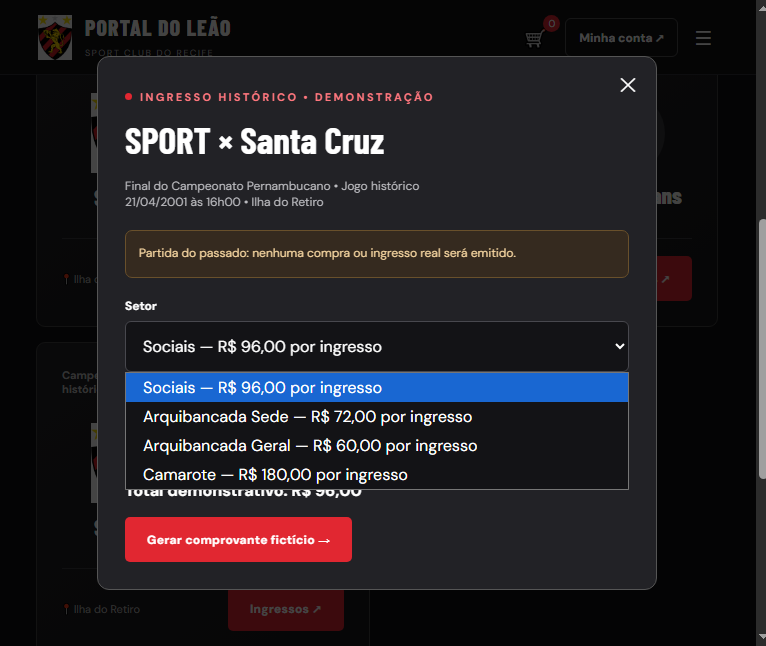

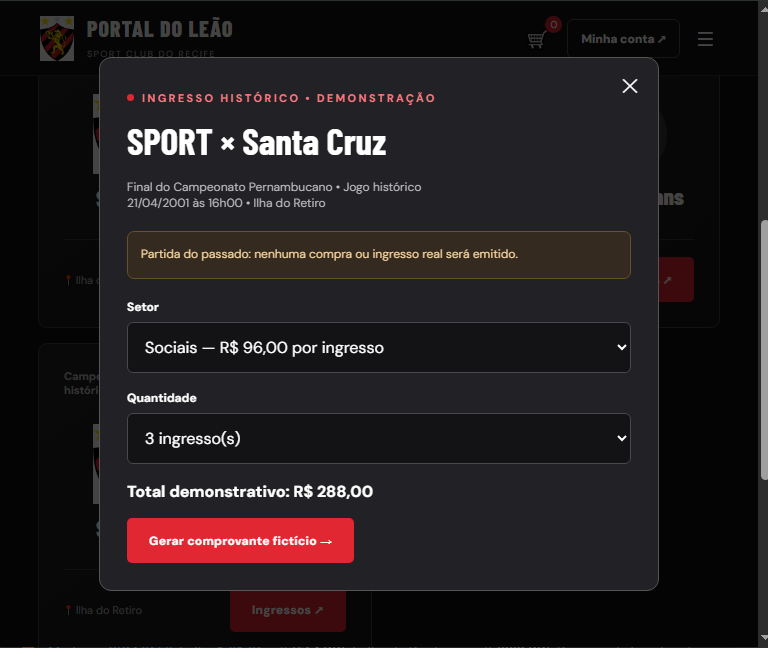

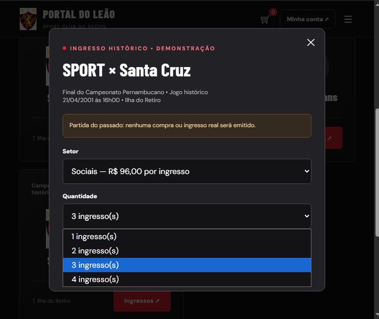

Ao confirmar, o sistema gera um **comprovante fictício** com partida, competição, data, horário, estádio, setor, quantidade, valor e protocolo. É possível imprimir ou usar a opção de **salvar como PDF do navegador**.

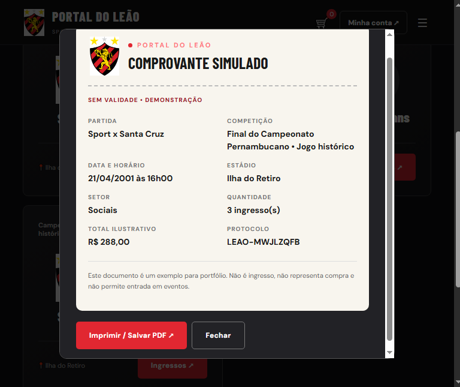

> **Importante:** partidas do passado, preços e comprovantes são apenas demonstrações. Nenhum documento gerado dá acesso a jogos ou representa compra real.

### 🛍️ Loja conceitual

Vitrine com camisas temáticas, boné, quadro ilustrativo da Ilha do Retiro e estátua de Magrão. Inclui categorias e carrinho de compras demonstrativo.

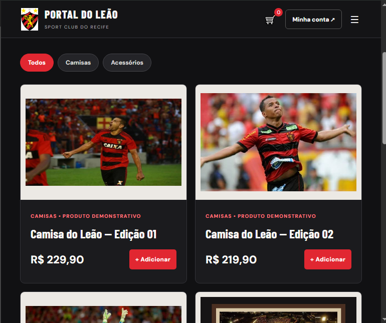

### 👥 Elenco

Área de apresentação **ilustrativa** de atletas, com filtros por posição. Os cards exibidos não constituem um elenco oficial atualizado.

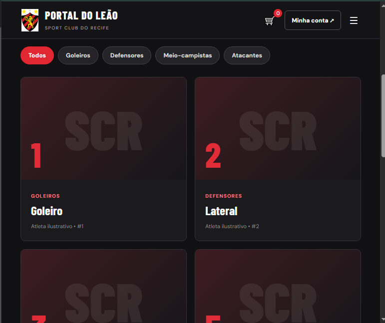

### 🔐 Login e área do torcedor

Cadastro e acesso demonstrativos, perfil do usuário e consulta aos comprovantes criados no próprio navegador.

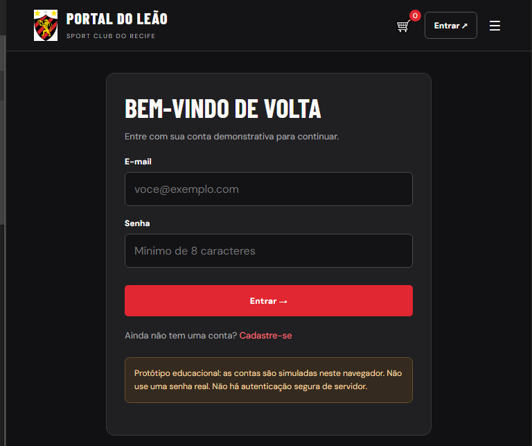

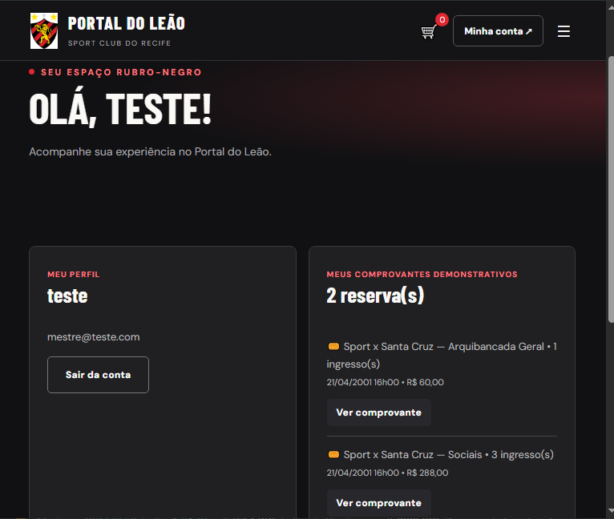

## Tecnologias

- **HTML5:** estrutura semântica das páginas.
- **CSS3:** estilos responsivos e identidade visual rubro-negra.
- **JavaScript (Vanilla JS):** navegação, interações, filtros, carrinho, autenticação demonstrativa e emissão de comprovantes.
- **localStorage:** persistência local de dados de demonstração no navegador.

## Mobile First 📱

O projeto foi construído priorizando a experiência em telas pequenas e adaptando progressivamente o layout a resoluções maiores. Entre os cuidados estão menu responsivo, cards em grade adaptável, formulários utilizáveis por toque e modais com rolagem.

## Como executar localmente

1. Clone o repositório ou baixe o projeto em ZIP.
2. Abra a pasta no **Visual Studio Code**.
3. Abra `index.html` com a extensão **Live Server** (recomendado).
4. Navegue pelas seções e experimente as funcionalidades demonstrativas.

Não é necessário instalar dependências ou executar um processo de build.

```bash
git clone https://github.com/SEU-USUARIO/SEU-REPOSITORIO.git
```

> Substitua o endereço acima pelo URL real do seu repositório, caso queira incluir o comando de clone.

## Estrutura de pastas

```text
Portal-do-Leao/
├── index.html
├── README.md
├── assets/
│   ├── app.js
│   ├── style.css
│   └── img/                 # Escudos e imagens utilizadas no site
└── docs/
    └── screenshots/         # Capturas reais das telas para o README
```

## Limitações e próximos passos

Este é um **protótipo front-end**. A autenticação e os dados são armazenados localmente e **não oferecem segurança de produção**: não utilize senhas pessoais reais. Também não existem integração de pagamento, venda de produtos, emissão oficial de ingressos, disponibilidade de setores em tempo real ou atualização automática de elenco e notícias.

Como evolução, o projeto pode receber uma API, banco de dados, autenticação segura, painel administrativo e integrações oficiais autorizadas.

## Fontes das matérias

- [UOL Esporte — Contratação de Diego Souza (2014)](https://www.uol.com.br/esporte/futebol/ultimas-noticias/2014/08/12/sport-oficializa-contratacao-de-diego-souza.htm)
- [Diario de Pernambuco — Declaração de Ciro sobre o Sport (2021)](https://www.diariodepernambuco.com.br/noticias/futebol/santacruz/2021/11/nao-jogo-em-outro-clube-de-pe-a-nao-ser-o-sport-diz-ciro-sobre-supo.html)
- [ge — Jogo de despedida de Magrão (2026)](https://ge.globo.com/pe/futebol/times/sport/noticia/2026/09/14/sport-marca-jogo-de-despedida-para-idolo-magrao.ghtml)

As imagens de notícias presentes no site são ilustrativas e provenientes dos arquivos fornecidos para o projeto, não reproduções extraídas dessas reportagens.

---

**Portal do Leão** — desenvolvido para fins educacionais e de portfólio. ❤️🖤


## Atualização — versão 3

- Foto de Ciro substituída pela imagem fornecida.
- Escudos dos adversários nas partidas e logos em PNG com fundo externo removido.
- Loja com imagens ampliadas, visualização de detalhes, descrição, seletor de 1 a 10 unidades e carrinho.
- 41 perfis **ilustrativos**: 3 goleiros, 5 zagueiros, 6 laterais, 4 volantes, 8 meias, 5 atacantes e 10 pontas. Cada perfil tem página individual e espaço para história e fotografia.
- Links para GitHub e LinkedIn do desenvolvedor no rodapé.

**Sobre imagens:** as fotos dos produtos foram redimensionadas e suavemente aprimoradas, mas isso não cria detalhes fotográficos ausentes nos arquivos originais. Para qualidade HD real, substitua-as por originais de alta resolução. As fotografias dos 41 atletas não foram fornecidas e, por isso, os perfis usam arte ilustrativa em vez de atribuir fotos a pessoas erradas.
